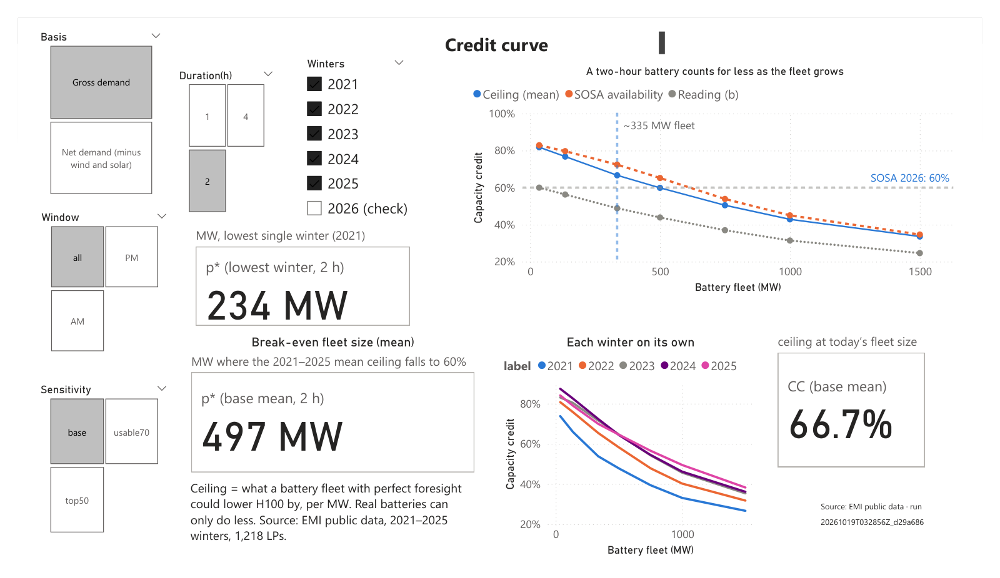

# nz-bess-peak-credit

**The question.** SOSA 2026 counts every battery of two hours or less at 60% of
nameplate in the North Island Winter Capacity Margin (NI-WCM), however many are
built. A two-hour battery can only flatten the part of the peak that is no
more than two hours wide. With more batteries the flattened top gets wider and
each extra MW holds the peak down by less. At what fleet size does the flat
60% overstate what a two-hour battery can physically deliver at the peak?

This repo rebuilds six North Island winters (2021–2026) from public Electricity
Authority EMI data and works out the most a battery fleet of a given size could
lower H100, the mean of the 200 tightest winter-daytime half-hours. The
battery has perfect foresight, so this is a ceiling. SOSA's 60% also covers
availability and behaviour (SOSA 2026 kept SOSA 2025's figure and checked it
against Rotohiko's offers with a state-of-charge model). The headline reads
the ceiling directly against 60% (reading a); RESULTS.md also gives the
ratio reading (b), which treats the two as multiplying, and SOSA's own
availability-style score (c).

Status: built end to end — data, six quality gates, calibration against
SOSA, peak shape, top-200 comparison, the 1,218-LP credit grid with p*,
publication to `outputs/current`, and a two-page memo
([memo/memo.pdf](memo/memo.pdf)). The Power BI report is built by hand from
`outputs/current` (see `powerbi/`). Numbers are in [RESULTS.md](RESULTS.md).
Headline: on the 2021–2025 average, a two-hour
fleet's physical ceiling falls to 60% at about 500 MW on gross demand and
430 MW on net, against about 335 MW on the grid once Huntly's battery is
commissioned; single winters range from 234 to 642 MW (gross).



## Data

All files come from EMI (`https://www.emi.ea.govt.nz/Wholesale/Datasets/…`,
served from `emidatasets.blob.core.windows.net`). Each one is pinned in
[data/manifest.csv](data/manifest.csv) by URL, download date, size and SHA-256.

| Dataset | Files | Used for |
|---|---|---|
| `Generation/Generation_MD` | monthly, 2021-04 … 2026-09 | kWh per half-hour per generating unit, with Fuel_Code and Tech_Code |
| `Metered_data/HVDC_Flows` | monthly | HVDC transfer at Benmore (BEN2201) and Haywards (HAY2201) |
| `Metered_data/Grid_export` | monthly | grid offtake at each GXP (reconciliation only) |
| `MappingsAndGeospatial/NetworkSupplyPointsTable` | `20261016_…` | POC → island |
| `Generation/GenerationFleet/Existing` | `20260702_DispatchedGenerationPlant.csv` | wind, solar and battery nameplate with in-force dates |

What the data turned out to say:

- **Batteries have their own code.** Fuel_Code `ELE`, Tech_Code `BAT`. Only
  Rotohiko (HLY0331) and Ruakākā (BRB0331) appear. The Glenbrook-Ohurua battery
  (GLN0332, 100 MW, in the fleet file from Dec 2025) has no row of its own;
  Huntly's battery was not commissioned before the data ends.
- **HVDC sign.** In `HVDC_Flows`, Flow_Direction `I` at a pole is energy
  injected into that island's AC grid and `X` is energy taken from it. So
  `hvdc_north_mw = (HAY2201 I − HAY2201 X) / 500`, positive south → north,
  net of link losses (Benmore `X` runs about 3% above Haywards `I`). The
  reconciliation confirms the sign (see below).
- Plants added since 2024 use three-letter fuel codes (`HYD`, `GEO`, `SOL`,
  `WIN`, `ELE`) while older plants keep the long names.
- The HVDC pole meters are not NSPs, so the island map also falls back to the
  POC's three-letter site code.

## Pipeline

```
ingest → stage → series → [G3 reconcile] → [G4 calibrate] → peak_shape, top200 → run_grid [G5]
       → observed → [G6 publish] → outputs/current → figures, memo, Power BI
```

| Step | Module | Output |
|---|---|---|
| ingest | `ingest.py` | `data/raw/<dataset>/*.csv`, `data/manifest.csv` |
| stage | `stage.py` | `data/staging/generation.parquet`, `hvdc.parquet`, `quarantine.parquet`, `quality_report.csv` |
| series | `series.py` | `data/series/ni_halfhourly.parquet` (one row per half-hour) |
| analyse | `reconcile.py`, `calibrate.py`, `peak_shape.py`, `top200.py`, `run_grid.py`, `observed.py` | `outputs/runs/<run_id>/`, ending with `DONE.txt` or `FAILED.txt` |
| grid | `run_grid.py` | `credit_table.csv` (one row per LP), `crossings.csv` (p*), `dispatch_d2.parquet`, `run_grid.log` |
| LP | `credit.py` | `min_top_k`, `min_top_k_no_new_peaks`, `shave_peak`, `capacity_credit` (NumPy + SciPy `linprog`, HiGHS) |
| observed | `observed.py` | `observed_vs_ceiling.csv`: what Generation_MD shows the batteries delivering at the peak, against the ceiling |
| publish | `publish.py` | gate G6, then `outputs/current/` with `run_manifest.json`, `dim_winter.csv`, `dim_p.csv`, `pbi_dispatch.parquet` |
| figures | `figures.py` | `memo/fig_credit_curve.png`, `memo/fig_p_star_by_winter.png` |
| memo | `memo/memo.qmd` | `memo/memo.pdf` (Quarto, Typst; `quarto render memo/memo.qmd --to typst`) |

The grid takes load **before** the batteries already on the grid
(`l_* + bess_mw`), treats a d-hour battery as delivering P × d MWh to the
grid, lets it run on every half-hour of the winter, and forbids charging that
would lift a half-hour outside 07:00–22:00 above the H100 line (see
RESULTS.md §5). `scripts/trace_pipeline.py` runs every step into
`outputs/trace/<run_id>/`, logs how the data changes shape at each one, then
checks that it reproduces the latest finished run (about 8 minutes):

```bash
uv run python -I scripts/trace_pipeline.py
```

North Island series: `l_gross_mw = gen_ni_mw + hvdc_north_mw`, where
`gen_ni_mw` is all North Island Generation_MD injection except batteries, and
`l_net_mw = l_gross_mw − wind_mw − solar_mw`. kWh per half-hour ÷ 500 = MW.
Local timestamps are generated per trading day in Pacific/Auckland, so
daylight-saving days have 46 or 50 half-hours.

### Quality gates

| Gate | Where | Rule | On failure |
|---|---|---|---|
| G1 | ingest | every file matches its SHA-256 pin | re-download once, then stop (`--update-manifest` accepts an EMI revision) |
| G2 | stage | six row rules: date parses; TP count matches the DST calendar; kWh ≥ 0; POC maps to an island; (date, POC, network, unit) unique; fuel code known | quarantine the row; stop if > 1% of a source is rejected |
| G3 | reconcile | NI supply − NI GXP offtake within 6–11% of supply each month | warning |
| G4 | calibrate | wind and solar peak factors within 2 pp of SOSA 2026 | stop; `--accept-gap REASON` records why and carries on |
| G5 | run_grid | every LP optimal; replayed dispatch reproduces H100; state of charge, power and energy within bounds; no off-window half-hour charged above the H100 line; CC never rises with P; CC never falls as duration grows (1 h ≤ 1.4 h ≤ 2 h ≤ 4 h) | stop after writing `credit_table.csv` and `crossings.csv` for inspection |
| G6 | publish | DONE.txt and no FAILED.txt; every output present with its contract columns; every LP through G5; one dispatch series per saved LP | do not publish; `outputs/current` keeps the previous version |

A run that finishes leaves `DONE.txt` in its folder; one stopped by a gate
or any other error leaves `FAILED.txt`. Run folders are named
`<UTC time>_<git sha>`, with `-dirty` when `src/`, `scripts/`, `config.yaml`,
`pyproject.toml` or `uv.lock` had uncommitted or untracked changes.

## Reproduce

Needs [uv](https://docs.astral.sh/uv/). About 275 MB of downloads.

```bash
uv sync
```

```bash
uv run bess all --accept-gap "<reason; see RESULTS.md>"
```

Steps can also run one at a time: `bess ingest`, `bess stage`, `bess series`,
`bess calibrate`, `bess grid` (calibrate, then the LP grid, about 6 minutes
on 6 workers), `bess analyse` (everything after series, including the grid:
about 7 minutes), `bess publish` (G6, then `outputs/current`) and
`bess figures`. Tests run offline on synthetic fixtures:

```bash
uv run pytest -q
```

## Limitations

See [RESULTS.md](RESULTS.md#limitations).
