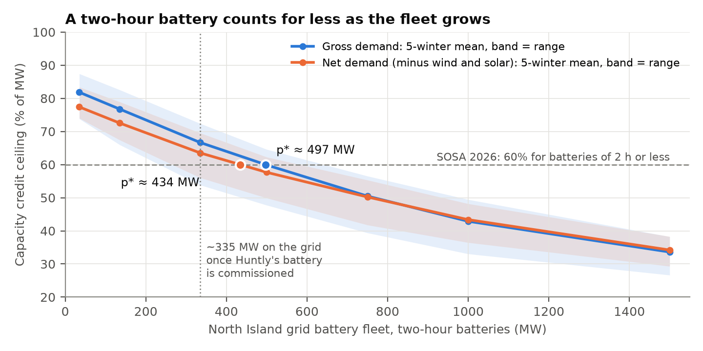
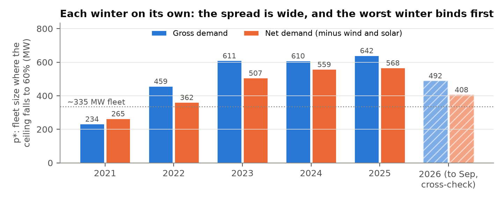

**The question.** SOSA 2026 counts every grid battery of two hours or less at
60% of its nameplate in the North Island Winter Capacity Margin, however many
are built. A two-hour battery can only flatten the part of the peak that is
less than two hours wide. Once the sharpest peaks are flattened, what is left
is wider, so each additional MW lowers the peak by less. At what fleet size
does 60% become more than a battery could physically deliver?

**The answer.** On the 2021–2025 average, the ceiling for a two-hour fleet
falls to 60% at **about 500 MW on gross demand and 430 MW on net demand**.
The North Island will have about 335 MW of grid batteries once Huntly's is
commissioned. That puts the crossing above today's fleet but inside the
pipeline SOSA 2026 already treats as committed. Single winters differ widely:
in a winter like 2021, the ceiling is already below 60% at 234 MW.

{width=100%}

**How it was measured.** For each of six winters (2021–2026), North Island
half-hourly demand was rebuilt from public Electricity Authority data: grid
injection plus HVDC transfer north, with wind and solar removed for the net
basis. A linear programme then gives a battery fleet of P MW and d hours
perfect foresight. The fleet charges and discharges on every half-hour from
1 April to minimise H100, the mean of the 200 tightest half-hours between
07:00 and 22:00. That is the demand measure the capacity margin is set
against. Credit is the fall in H100 per MW, so the result is a **ceiling**:
real batteries hold reserves, do not know the load in advance and are not
always full, so they can only deliver less.

**Why the credit falls.** Even a 35 MW battery reaches only 82%, not 100%. The
top 200 half-hours fall on 35–46 days, often four or five on the same day, so
the coldest days need more than two hours of cover. Every extra MW must cover
a wider slice of the peak. By 1,000 MW the ceiling is 43%.

**Three readings of the same result.**

- *Ceiling against 60%* (the headline). Above p\*, 60% is too high whatever
  the batteries' behaviour.
- *Same behaviour, bigger fleet.* If 60% is right for a 35 MW battery like
  Rotohiko, holding that behaviour fixed and scaling it by the fall in the
  ceiling gives about **49% at 335 MW** and **31–34% at 1,000 MW**. This
  is the most robust reading: the ratio barely moves when the energy
  convention or the basis changes.
- *SOSA's own scoring.* SOSA scores wind and solar by mean output over the
  original top 200. Scored that way, the same dispatch rates 1–6 points
  higher, most around p\*, and p\* moves out to about 600 MW. The gap is the shoulder hours
  that rise into the top 200 once the peak is flattened. H100 counts them;
  per-period scoring does not.

{width=100%}

**What it could mean for SOSA 2027 and the SSAD review.**

- Make the battery factor depend on fleet size and duration, as the
  effective load-carrying capability methods used by PJM and in California do.
  A lookup table from this method (fleet × duration → factor) can be rebuilt
  each year in minutes.
- Report the factor per winter, not only as an average. The coldest winter
  binds first.
- Check how SOSA's state-of-charge model debits energy across consecutive
  peak half-hours. On H100, a one-hour battery's ceiling is 46–49% even at
  35 MW, below the 60% applied to all batteries of two hours or less.

**What this is not.**

- It is not a forecast of battery behaviour.
- Generation_MD shows energy only. In winter 2026 the two batteries it can see,
  Ruakākā and Rotohiko, delivered 19% of their nameplate as energy across the
  top 200 half-hours, against a 76% ceiling for a fleet of their size. Much of
  their peak value is reserve, which this data cannot see, and Glenbrook and
  Huntly have no rows at all.
- Demand is grid-view, so embedded generation and rooftop solar are already
  netted off.
- H100 over 200 half-hours is the SSAD's measure. Scoring only the 50 tightest
  half-hours pushes p\* out to 700–800 MW, so the choice of tail matters.
- History is not the future: demand growth and time-of-use pricing will
  reshape the peaks.

**Reproducibility.** Every number above can be traced to a run. The
200 input files are pinned by SHA-256, and six quality gates check every run.
Four stop it outright, among them replay checks on all 1,218 LPs. The energy
reconciliation only warns, and no month fell outside its band. The calibration
against SOSA's published wind and solar factors stops a run unless the gap is
explained: 2024 solar is 3.5 points off and was accepted, for the reason given
in RESULTS.md, since solar barely shows in the winter peak. A trace script
rebuilds every output from the raw files and confirms they match exactly.
Code, results and limitations are at github.com/Kenchch/nz-bess-peak-credit.
